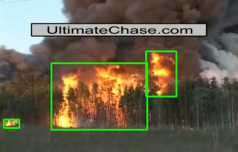

# Fire Detection with Color Segmentation

A small computer vision exercise done for a graduate Computer Vision course (Assignment 1).
The goal is to detect fire regions in forest video frames using classical, color-based segmentation
with OpenCV — no learning involved.

## Approach (`fire_detection_hsv.ipynb`)

1. Convert the frame to HSV and threshold: hue 0–40 (red → yellow), saturation ≥ 130 (drops smoke/clouds), value ≥ 150 (bright pixels only).
2. Morphological opening (3×3) to remove small noise.
3. Dilation (5×5) to merge nearby flame fragments into one region.
4. Find external contours and draw a bounding box around each region.



## Other notebooks

- `compare.ipynb` — compares median channel values of a fire patch vs. a non-fire patch in RGB, HSV, Lab and YCrCb to see which space separates them best.
- `fire_ycrcb.ipynb` — alternative YCrCb rule (`Y > 200` and `Cr > Cb`) with histograms and interactive sliders for tuning.

## Files

- `frame_0216.png` — sample frame used in the main notebook
- `011.png`, `022.png` — fire / non-fire patches used in `compare.ipynb`
- `data/` — source forest videos
- `results/` — output images

## Requirements

```bash
pip install opencv-python numpy matplotlib ipywidgets
```
